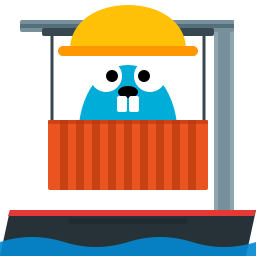

<p align="center">
  
</p>

# Dockyard

A shared, cluster-agnostic Go e2e framework. It provisions a real platform (a
`kind` cluster or an existing kubeconfig), docks your vessel into it, and runs
sea trials. Built on [`sigs.k8s.io/e2e-framework`](https://github.com/kubernetes-sigs/e2e-framework).

Naming system: the framework is the **dockyard**; each repo's thing-under-test is a
**vessel** fitting out (the `Vessel` seam); the installers (`Deps`) are the
**fitting-out**; the tests are **sea trials**.

## The Vessel contract (the seam)

Dockyard (L1) owns cluster lifecycle, suites/labels, and the generic installers. A
consumer (L3) supplies a `Vessel` — the thing under test plus the dependencies
and CRD types it needs:

```go
type Vessel interface {
    InstallDeps(e *Environment) []env.Func        // compose via install.NewDeps()
    AddTypesToScheme() env.Func                    // register the repo's CRD types
    Enabled() bool                                 // run the control plane?
    Install() (setup []env.Func, teardown env.Func) // controller etc.
}
```

Set it in `TestMain` with `env.WithVessel(p)` before flags are parsed, then
compose setup from `env.CreateClusterFunc()`, `env.Vessel().InstallDeps(&env)`,
`env.Vessel().AddTypesToScheme()`, and (when `Enabled()`) `env.Vessel().Install()`.

## Layers

- **L1 — Dockyard (this repo).** Generic, no product-specific knowledge. Cluster
  lifecycle (`dockyard`), the generic installers + `Deps` builder (`install`), the
  per-test feature helpers (`feature`), the gateway HTTP SDK (`gateway`), and the
  recorder sim (`sim/recorder`, published as an image).
- **L2 — platform conventions.** Org/platform-specific provisioning (service-ca
  stand-ins, provider-HTTPS contracts, kuadrant auth policy). Lives in the consumer
  for now; extract a shared layer only once a 2nd consumer confirms the shape.
- **L3 — per repo.** The `Vessel` implementation, CR fixtures, and test files.

## Packages

| Package        | What it holds                                                        |
|----------------|---------------------------------------------------------------------|
| `dockyard`     | `Environment`, the `Vessel` seam, suites, labels, cluster lifecycle |
| `install`      | Generic installers (metallb, Gateway API, istio, cert-manager, kuadrant), CRD/image/manifest steps, delegation primitives (`Helm`/`Script`/`Manifest`), and the `Deps` builder |
| `feature`      | Per-test `features.Func` helpers (apply/create/delete, waits, `GatewayClient`) |
| `gateway`      | A thin HTTP SDK for OpenAI-compatible gateway endpoints              |
| `sim/recorder` | A self-identifying sim backend (own module; published as an image)   |

## Two modes

A consumer picks per `Deps` chain:

- **Lightweight** — Dockyard installs the infra add-ons and the consumer runs its
  controller in-process.
- **Full platform** — the product's own installer (a `deploy.sh`, a helm chart,
  operators) stands everything up via the delegation primitives
  (`WithScript`/`WithHelm`/`WithManifest`); Dockyard just drives the
  trials. Dockyard never double-installs because the consumer composes the chain.

## External tools

Manifest apply and readiness waits run in-process against the API server (klient
decoder + resources client, server-side apply) — **no `kubectl` binary** — and both
Helm releases and istio (via its official Helm charts) go through the Helm Go SDK, so
there is **no `helm` or `istioctl` binary** either. The only external tools Dockyard
shells out to are `docker` and `kind` (building and loading images — no practical Go
path), and only when the installer that needs them is composed into the chain:

| Tool     | Needed by                                           |
|----------|-----------------------------------------------------|
| `docker` | `WithBuiltImage`, `WithRecorder`; `WithMetalLB` only to derive the pool (avoid with `MetalLBAddressPool`) |
| `kind`   | cluster create (`-create-cluster=true`), and image load (`WithImage`/`WithBuiltImage`/`WithRecorder`) |

These are inherent to the **local-kind** workflow: a kind cluster runs Kubernetes
nodes as containers, so it needs a container runtime regardless. Running against an
existing cluster (`-create-cluster=false`) with images referenced from a registry
needs neither tool, and a control-plane-only vessel never touches them.

## Recorder

The recorder sim is published as an image (`ghcr.io/praxis-proxy/dockyard-recorder`)
so consumers reference it via `Deps.WithRecorder(...)` instead of building it from
source. `WithBuiltImage` remains for a consumer's own sims.
